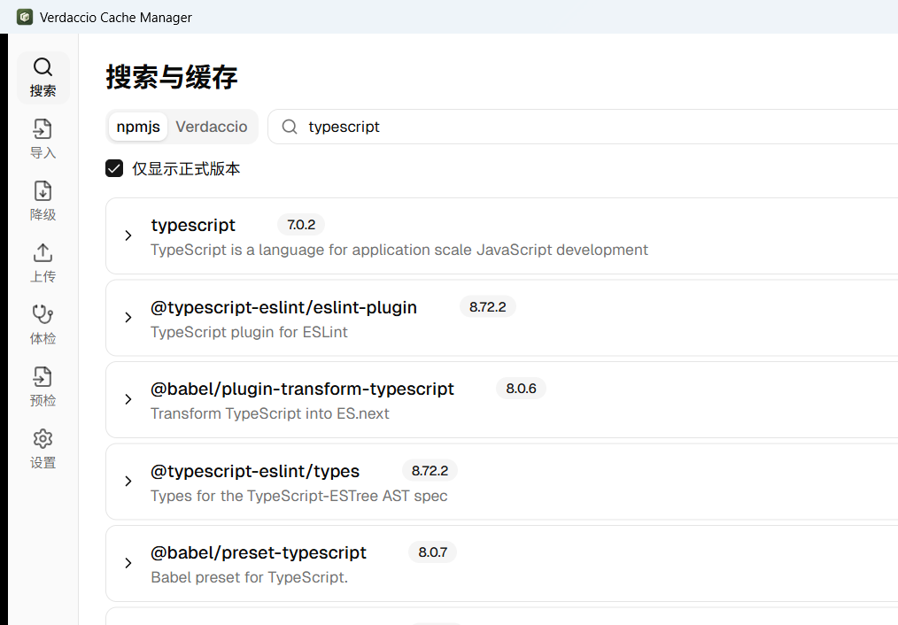
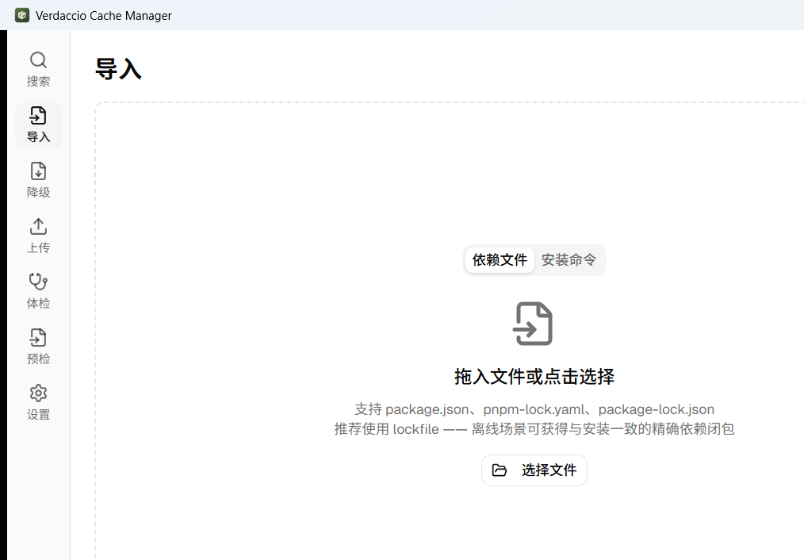
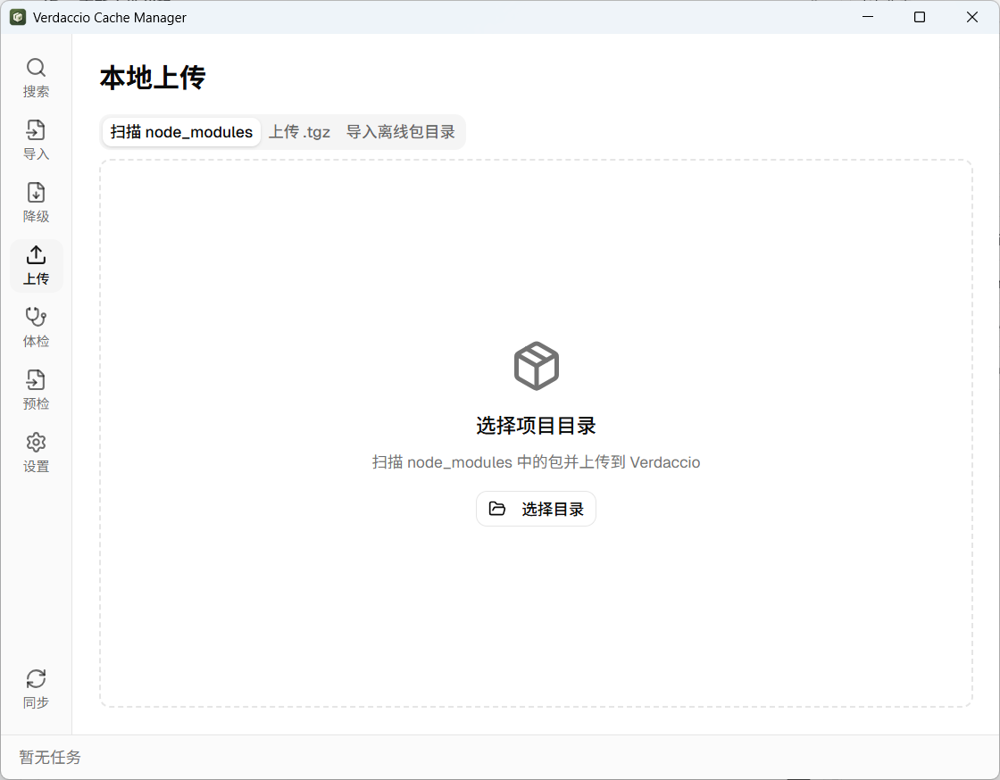
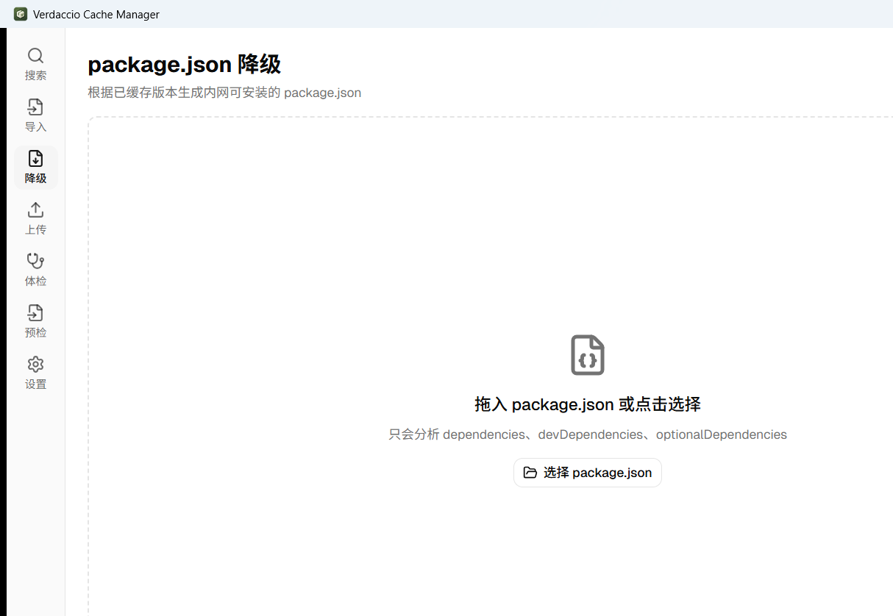
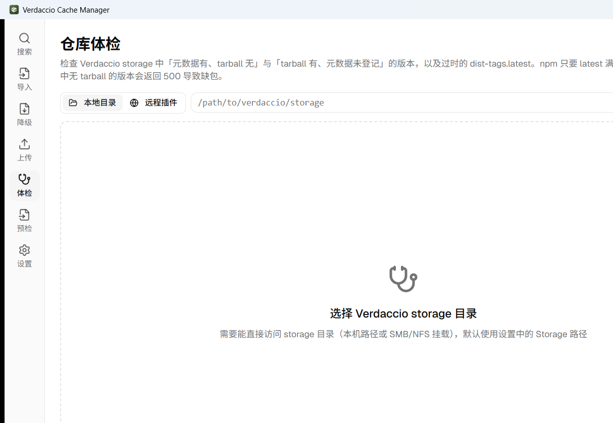
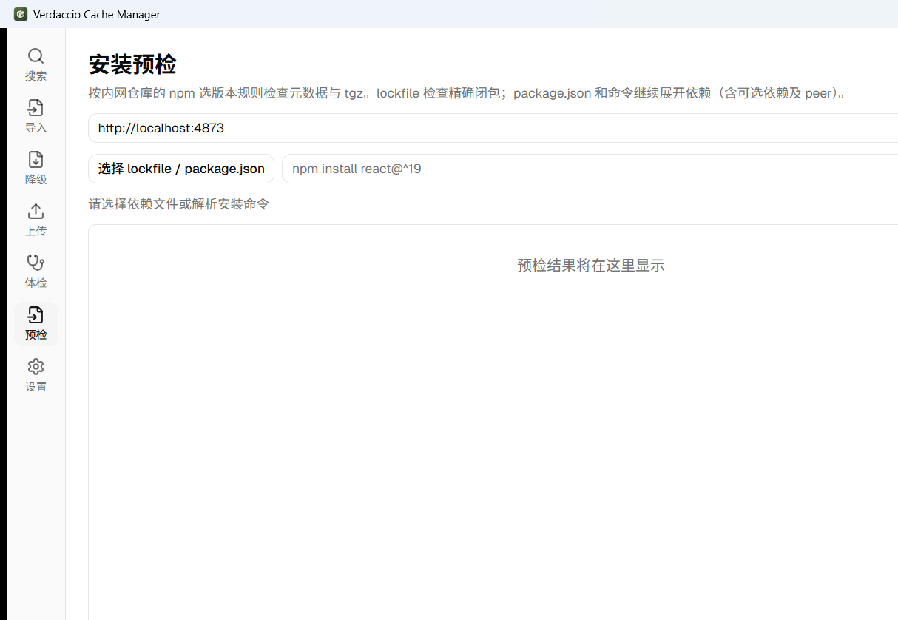
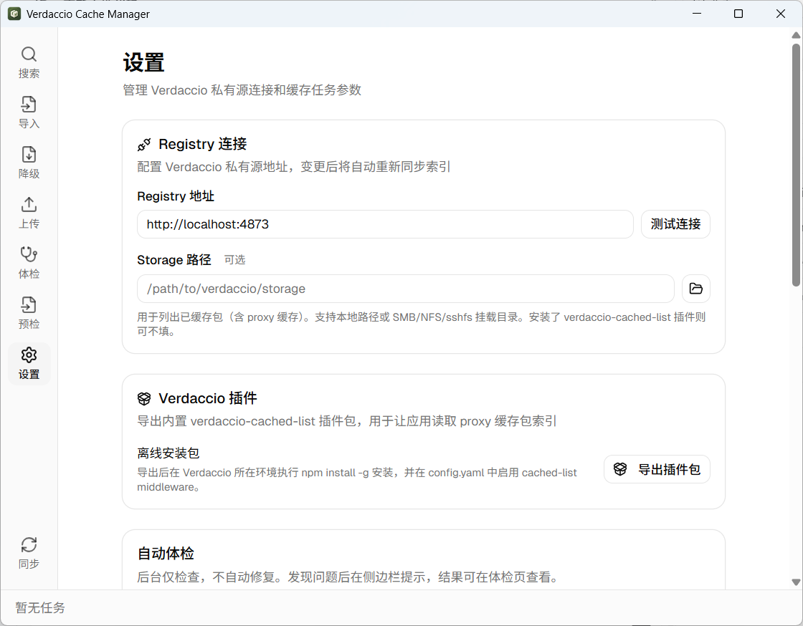

<p align="center">
  
</p>

<h1 align="center">Verdaccio Cache Manager</h1>

<p align="center">
  
  
  
  
</p>

一个用于把 npm 包预热到私有 [Verdaccio](https://verdaccio.org/) 的桌面应用。它把公网搜索、依赖解析、离线补包、仓库体检和安装前检查放在同一条工作流里，适合没有公网访问权限的内网环境。

技术栈：Tauri v2 · React 19 · TypeScript · Rust（tokio）· shadcn/ui · Tailwind CSS · zustand。

## 功能地图

| 页面 | 入口 | 适用场景 | 主要操作 |
|------|------|----------|----------|
| 搜索 | `/` | 在线查找包和版本 | 搜索 npmjs、查看 Verdaccio 缓存、批量缓存、导出 tarball、管理版本 |
| 导入 | `/import` | 从项目依赖开始预热 | 读取 `package.json`、`pnpm-lock.yaml`、`package-lock.json`、安装命令或 `replenishment.json` |
| 降级 | `/downgrade` | 内网只能安装已缓存版本 | 分析 package.json，按同 major 优先生成降级文件，必要时允许跨 major |
| 上传 | `/upload` | 把本地文件带入私服 | 扫描 `node_modules`、上传 `.tgz`、导入离线包目录并校验 manifest |
| 体检 | `/health` | 检查 Verdaccio 离线可安装性 | 扫描本地 storage 或远程插件，发现幽灵版本、未登记 tarball、缺失或过时 latest，并修复 |
| 预检 | `/preflight` | 安装前确认依赖可下载 | 解析 lockfile/package.json/安装命令，逐项检查 tarball，导出精确补包清单 |
| 设置 | `/settings` | 配置运行环境 | Registry、Storage、插件包、自动体检、并发/重试/超时、目标 Node 版本和索引 |

典型的外网补包闭环是：在「预检」或「体检」导出 `replenishment.json` → 在外网机器的「导入」页导入清单并导出 tarball → 将目录带入内网 → 在「上传」页导入离线包目录 → 重新执行「体检」确认仓库健康。

---

## 截图

截图来自本机已安装的 Windows 客户端 v0.1.44。完整文件清单、截图状态和复现说明见 [`docs/screenshots/README.md`](docs/screenshots/README.md)。

### 搜索与缓存

在 **npmjs** 标签下搜公网包，按勾选的版本批量推送；切到 **Verdaccio** 标签可查看私服已缓存的包并继续操作。storage 中有 tarball 但元数据未登记的版本会标记为「未登记」。



### 依赖文件导入

拖入 `package.json` / `pnpm-lock.yaml` / `package-lock.json`，或粘贴 npm/pnpm/yarn/bun 安装命令，自动解析依赖并标记哪些版本尚未缓存。`replenishment.json` 会保持精确版本，不再重新解析范围。



### 本地上传

选择本地项目目录，扫描 `node_modules` 并对比已缓存索引；也支持单独上传 `.tgz` 或导入带 manifest 的离线包目录。



### package.json 降级

分析 dependencies、devDependencies 和 optionalDependencies，按同 major 优先生成内网可安装的 package.json；结果可筛选、另存为或备份后覆盖原文件。



### 仓库体检

支持本地 storage 和远程插件模式，检查无 tarball、latest 缺失/过时以及 tarball 未登记，并可复制或导出补包清单、批量修复。



### 安装预检

选择 lockfile/package.json 或解析安装命令，逐项检查目标 Registry 是否真的有可下载 tarball，并可导出 `replenishment.json`。



### 设置

配置 Verdaccio 地址、可选 storage 路径、插件包、自动体检、并发数、重试与超时；同步本地缓存索引。



## 安装

从 [Releases](../../releases) 下载对应平台的安装包：

| 平台 | 文件 |
|------|------|
| macOS (Apple Silicon) | `*_aarch64.dmg` |
| macOS (Intel) | `*_x64.dmg` |
| Windows | `*_x64-setup.exe` / `*_x64_en-US.msi` |
| Windows（内网 / 旧 WebView2） | `*_offline-webview2-setup.exe` / `*_offline-webview2.msi` |
| Linux | `*_amd64.deb` / `*_amd64.AppImage` |

> 应用未签名，首次打开 macOS 可能需要在「系统设置 → 隐私与安全性」放行。
> `offline-webview2` Windows 包会内置 WebView2 离线安装器，安装包更大，适合不能联网或系统 WebView2 版本过旧的机器；普通 Windows 包保持原来的较小体积。

## 近期更新

**v0.1.45**
- 导出 tarball 支持中途取消；网络错误自动重试，大文件不再因总超时中断。

**v0.1.44**
- 修复 npm alias（`npm:real-pkg@range`）依赖解析，避免平台二进制依赖被漏掉。

**v0.1.43 / v0.1.42 / v0.1.41**
- 修复导入重新选择、离线目录上传状态和页面切换时任务进度丢失问题。

**v0.1.40**
- 新增孤儿 tarball 检测和登记修复，避免 storage 中有文件但 npm 看不到版本。

**v0.1.39**
- 新增安装预检、自动体检、精确补包清单和离线包 `manifest.json` 校验，形成外网补包到内网导入的闭环。

**v0.1.38 / v0.1.37**
- 新增远程插件体检和仓库体检页，支持修复幽灵版本、无效 latest 和空壳包。

**v0.1.27**
- 修复本地上传包后安装时 EINTEGRITY 校验失败及依赖丢失问题
- 离线场景下 Verdaccio 仅有 uplink metadata 而无本地 tarball 时，自动 unpublish 后重新 publish

**v0.1.26**
- 依赖解析支持 optionalDependencies 与失败容错
- 搜索页包名增加一键复制按钮
- 导出 tarball 时在 sonner toast 中显示实时下载进度
- 导出 tarball 单包失败不再中止整批，结束后始终弹出汇总提醒

**v0.1.12 / v0.1.11**
- 全新应用图标：macOS squircle 风格，深森林绿配等距 3D 包裹盒，呼应 Verdaccio 品牌

**v0.1.10**
- 并发上传 npm 包时不再每包重复登录 Verdaccio，整个扫描任务只触发 1 次登录请求，消除大量 409 日志和密码验证开销

**v0.1.8**
- 扫描 node_modules 后自动比对已缓存包，默认仅勾选未缓存项
- 扫描页上传时显示按钮 loading 与逐包状态徽章
- Publish 413 错误给出明确修复提示（调大 Verdaccio `max_body_size`）

**v0.1.5**
- 新增导出 tarball 到目录功能
- 支持 proxy 关闭时从本地 node_modules 上传
- 本地 SQLite 缓存索引，增量同步已缓存包列表
- 依赖解析支持递归缓存
- 设置页 UI 重构

完整变更见 [CHANGELOG.md](CHANGELOG.md)。

## 快速开始

1. 启动应用。
2. 打开「设置」，填写 Verdaccio 地址（例：`http://localhost:4873`），点「测试连接」并保存；需要读取 proxy 缓存时同时填写 Storage 或安装插件。
3. 进入「搜索 / 导入 / 上传」任一页面，选包后点「上传/缓存到私服」；任务进度在底部任务栏实时显示，失败可重试。
4. 用「体检」检查仓库元数据和 tarball，用「预检」确认目标依赖可下载；缺包时导出 `replenishment.json` 走离线补包流程。
5. 内网只能安装旧版本时，在「降级」页生成新的 package.json。

## 文档索引

- [`docs/feature-guide.md`](docs/feature-guide.md)：按页面说明输入、结果和推荐流程。
- [`docs/automatic-storage-health.md`](docs/automatic-storage-health.md)：自动体检的配置、触发条件和提示。
- [`docs/offline-bundle-format.md`](docs/offline-bundle-format.md)：`replenishment.json`、`manifest.json` 和离线目录校验规则。
- [`docs/storage-health-testing.md`](docs/storage-health-testing.md)：真实 Verdaccio 集成测试和故障排查。
- [`docs/screenshots/README.md`](docs/screenshots/README.md)：截图索引、状态说明和重新采集方法。

## 配套插件：`verdaccio-cached-list`（可选）

Verdaccio 内置 `/-/verdaccio/data/packages` 只能列出本地 **publish** 的包，**proxy 缓存**的包不在结果里。

仓库内 [`verdaccio-cached-list/`](verdaccio-cached-list) 是一个 Verdaccio 中间件插件，扫描存储目录暴露 `GET /-/cached-packages`，让"搜索 Verdaccio 已缓存"功能可以看到 proxy-cached 的包。

```bash
# 在 Verdaccio 容器内安装
npm install -g verdaccio-cached-list
```

```yaml
# config.yaml
middlewares:
  cached-list: {}
```

详见插件 README：[`verdaccio-cached-list/README.md`](verdaccio-cached-list/README.md)。

## 开发

需要 Rust toolchain（stable）、Node 22+、pnpm 10+。Linux 还需 webkit2gtk 等依赖，参考 [Tauri 前置依赖](https://tauri.app/start/prerequisites/)。

```bash
pnpm install
pnpm tauri dev    # 启动开发模式
pnpm tauri build  # 打包当前平台
```

仅前端调试：

```bash
pnpm dev          # vite dev server (无 tauri shell)
pnpm tsc --noEmit # 类型检查
```

## 架构

```
轻量操作: React → invoke Command → Rust 同步处理 → 返回结果
重操作:   React → invoke Command(启动任务) → Rust task_engine 异步执行
                ← emit Event ← 实时进度推送
```

Rust 模块（`src-tauri/src/`）：

| 模块 | 职责 |
|------|------|
| `registry_client` | npm registry / Verdaccio HTTP API（搜索、下载、PUT publish），共享登录 token |
| `parser` | 解析 `package.json` / `pnpm-lock.yaml` / `package-lock.json` |
| `dependency_resolver` | 递归解析依赖树，根据 semver 选定具体版本 |
| `install_preflight` | 检查安装输入和每个依赖的 tarball 可用性 |
| `package_downgrade` | 根据缓存索引生成可安装的 package.json |
| `task_engine` | 异步任务队列，并发 + 重试 + 进度上报 |
| `local_scanner` | 扫描 `node_modules`、解析 `.tgz` |
| `storage_scanner` | 从 Verdaccio storage 读取已缓存包和孤儿版本 |
| `storage_health` | 体检、生成补包清单并修复元数据 |
| `offline_bundle` | 校验离线目录、manifest、integrity 和 latest 推进 |
| `cache_db` / `sync_engine` | SQLite 本地索引和与 Verdaccio 的增量同步 |
| `config` | 配置持久化 |

功能设计：[`docs/superpowers/`](docs/superpowers/)。页面使用说明见 [`docs/feature-guide.md`](docs/feature-guide.md)。

## 发布流程

推送 `v*` tag 即触发 GitHub Actions 多平台构建并起草 Release：

```bash
# 1. 同步升级四处版本号
#    - package.json
#    - src-tauri/tauri.conf.json
#    - src-tauri/Cargo.toml
#    - README.md  (version badge)
cargo update -p verdaccio-cache-manager  # 刷新 Cargo.lock

# 2. 提交版本变更
git commit -m "chore: bump version to <version>"

# 3. 基于 git log <prev-tag>..HEAD 生成 CHANGELOG.md 条目并提交
git commit -m "docs: update changelog for v<version>"

# 4. 先推 main，确认与远程同步后再打 tag
git push origin main
git tag v<version>
git push origin v<version>
```

> ⚠️ **tag 必须打在 `origin/main` HEAD 上**。如果打 tag 后再向 main 推 commit，重跑 release workflow 会因 GitHub API 限制返回 403（`GITHUB_TOKEN` 无法对非默认分支 HEAD 创建 release）；如需追加变更，请走下一个 patch 版本。

完整发布约束详见 [CLAUDE.md](CLAUDE.md)。工作流定义：[`.github/workflows/release.yml`](.github/workflows/release.yml)。

## License

MIT
